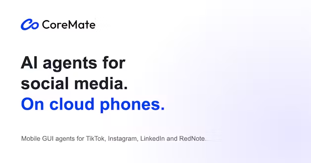

  

  <a href="README.md">English</a> · <a href="README.zh-CN.md">简体中文</a> · <a href="README.ja.md">日本語</a> · <a href="README.ko.md">한국어</a> · <a href="README.es.md">Español</a> · <a href="README.pt-BR.md">Português</a> · <a href="README.fr.md">Français</a>

# Coloque agentes de IA para trabalhar na prospecção em redes sociais

**Uma equipe de IA para times de redes sociais e crescimento.** Coordene contato com criadores e clientes, publicações e acompanhamento em celulares na nuvem gerenciados, com sua equipe no controle.

[Visite o site ↗](https://www.core-mate.com/)

  

## 💬 O trabalho de que ninguém fala

Boa parte da prospecção em redes sociais ainda é difícil de delegar a um software. Muitas ações essenciais dentro dos aplicativos carecem de integrações públicas adequadas.

Pense em como sua equipe entra em contato com criadores e clientes hoje. Alguém abre uma planilha de contatos e escreve uma primeira mensagem que pareça pessoal. Depois vêm o copiar e colar, os retornos no terceiro e no sétimo dia, a conferência de respostas e as colunas de status que nunca batem.

Agências contratam assistentes virtuais para enviar mensagens e atualizar planilhas manualmente. Funciona até a lista crescer de 50 para 200 criadores ou um cliente pedir 500 contatos por dia. A planilha acaba virando um gargalo.

TikTok, Instagram e LinkedIn impõem limites às integrações de mensagens e às permissões de acesso. Ferramentas de agendamento e gestão cobrem publicações e relatórios, enquanto algumas conversas e acompanhamentos dentro dos aplicativos continuam manuais.

**É essa lacuna que o CoreMate foi criado para preencher.**

## ✨ O que é o CoreMate?

O CoreMate é uma equipe de IA para aplicativos sociais. Seus agentes tocam na tela, digitam, leem telas, enviam mensagens e registram resultados em aplicativos móveis reais, usando celulares na nuvem que hospedamos, atualizamos e mantemos.

Descreva um objetivo com suas próprias palavras. Os agentes organizam etapas que sua equipe pode revisar e executam tarefas em paralelo nos celulares configurados. Os registros permitem acompanhar o trabalho.

### 📱 Trabalho dentro dos aplicativos

Realize conversas, acompanhamentos e fluxos específicos de cada plataforma pela interface do aplicativo. As tarefas disponíveis dependem da plataforma, das permissões da conta e dos fluxos compatíveis.

### 🎯 Feito para equipes de redes sociais

Sem precisar programar. Comece com um roteiro integrado ou descreva sua própria tarefa. Combine etapas, conteúdo e escopo com a equipe antes de executar.

### 🤝 Sua equipe mantém o controle

A equipe revisa comunicações e decisões de publicação, define um ritmo adequado para cada conta e confere os resultados nos registros. Pessoas assumem quando uma conversa ou verificação da plataforma exige atenção.

## 🧭 Trabalho que você pode delegar aos agentes

| Caso de uso | O que sua equipe pode desenvolver |
| --- | --- |
| 🤝 **Contato com criadores** | Pesquisar perfis relevantes, preparar convites personalizados, coordenar amostras e acompanhar parcerias para vendedores do TikTok Shop e marcas DTC. |
| 💬 **Prospecção de clientes e B2B** | Preparar mensagens pessoais com base em listas e necessidades comerciais claras, organizar retornos e reduzir o copiar e colar. |
| 🌍 **Operação de várias contas** | Coordenar contas autorizadas de marcas e clientes em diferentes mercados, com tarefas e registros em um só espaço de trabalho. |
| 📝 **Publicação e acompanhamento** | Publicar conteúdo e acompanhar comentários e respostas por meio de fluxos compatíveis no TikTok, Instagram, LinkedIn e X. |

## 🚀 Quatro etapas para começar

### 1. Defina o objetivo

Escolha aplicativos, contas, fluxos de trabalho e a quantidade de celulares necessária. Combine o escopo e os critérios de sucesso antes de executar.

### 2. Prepare os celulares na nuvem

Preparamos seu espaço de trabalho e seus celulares. Entre nas suas próprias contas dentro deles e deixe as tarefas escolhidas prontas.

### 3. Valide um fluxo real

Conclua uma tarefa de ponta a ponta. Revise registros e resultados, ajuste o fluxo e amplie o uso quando ele atender à equipe.

### 4. Expanda com suporte

Adicione contas e celulares conforme o trabalho aumentar, com guias de operação, manutenção para mudanças nos aplicativos e suporte da nossa equipe.

## 🔎 Comparação do CoreMate

| Recurso | CoreMate | Suítes de redes sociais¹ | Agentes de uso do computador | Frameworks de agentes móveis |
| --- | :---: | :---: | :---: | :---: |
| Fluxos móveis no TikTok, Instagram, LinkedIn e X | ✓ | — | — | ✓ |
| Ações no aplicativo além das integrações públicas disponíveis | ✓ | — | — | ✓ |
| Feito para equipes de redes sociais | ✓ | ✓ | — | — |
| Planejamento a partir de objetivos em linguagem natural | ✓ | — | ✓ | ✓ |
| Roteiros integrados | ✓ | — | — | — |
| Celulares na nuvem totalmente gerenciados incluídos | ✓ | — | — | ✓ |
| Execução paralela em vários celulares | ✓ | — | — | ✓ |
| Sem programação | ✓ | ✓ | ✓ | — |
| Opção de implantação privada | ✓ | — | — | ✓ |

¹ Exemplos incluem Hootsuite e Sprout Social. O traço indica que esta comparação não identifica o recurso. As funções e os fluxos compatíveis variam conforme o produto e o plano.

As suítes de redes sociais costumam focar em agendamento e relatórios. Assistentes de computador de uso geral cobrem tarefas de desktop, e frameworks de agentes móveis atendem desenvolvedores. O CoreMate reúne fluxos de aplicativos móveis, celulares gerenciados e coordenação de equipes para a operação diária das redes sociais.

## 🛡️ Prospecção com supervisão humana

Use apenas contas que sua equipe está autorizada a gerenciar. Mantenha a comunicação personalizada, ligada a uma necessidade comercial real e em um ritmo adequado. Pessoas assumem verificações da plataforma e decisões que exigem julgamento. A equipe é responsável pela revisão do conteúdo e pelas decisões de publicação.

## Comece com o CoreMate

Escolha um fluxo real, valide os resultados com sua equipe e amplie para mais contas e celulares. Conheça as demonstrações, os planos atuais e o processo de integração no site.

[Explore o CoreMate ↗](https://www.core-mate.com/) · [Fale com a equipe](mailto:support@core-mate.com)
